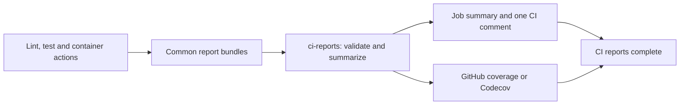

# ADR 0004: Unify CI reporting across the Hoverkraft actions

- Status: accepted, implementation validation in progress
- Date: 2026-11-26
- Scope: common reporting, language CI and container test producers
- Related: [ADR 0005](0005-independent-reporting-releases.md) defines independent CI and release ordering.

## Context

The current coverage proposal adds a second artifact stream and a separate public
publication workflow. The previous proposal selected providers in test actions, repeat component
labels in the collector and forward artifact IDs to another job. Producers also
duplicate parsing, artifact naming and comments. The shared linter requires a
particular calling job name. These details make ordinary CI configuration harder.

Breaking changes are allowed. The target is one coherent lint, test and coverage
reporting process. This revision replaces the earlier proposal before acceptance. The language
producer PRs adopt the shared contract. Live native publication remains a separate
acceptance step on an eligible repository.

## Decision

### One reporting entry point

Keep `ci-reports.yml` as the only public reporting workflow. It collects results,
validates completeness, publishes a summary and one persistent CI comment, and
uploads coverage when requested. Internal jobs retain separate permissions;
callers do not wire another publication workflow or forward artifact IDs.



Language and container actions own execution, native report generation and local
job diagnostics. They use one common `record-ci-reports` action to retain results,
without selecting providers or posting PR comments. Reuse the existing parser
and coverage validators. The recorder does not install a test framework or guess
how a project generates coverage.

### Caller experience

For standard reusable workflows, the target caller configuration is:

```yaml
reports:
  needs: [lint, backend, frontend]
  if: ${{ always() }}
  uses: hoverkraft-tech/ci-github-common/.github/workflows/ci-reports.yml@<commit-sha>
  permissions:
    contents: read
    pull-requests: write
    code-quality: write
    id-token: write
  with:
    job-results: ${{ toJSON(needs) }}
    coverage: github
```

Producer workflows expose their report plans through `needs` automatically. There
is no mandatory configuration file, repeated inventory, per-producer
`comment: false`, outer job naming convention or public artifact ID plumbing.

The central `coverage` input selects `none` (default), `github` or `codecov`.
`none` disables external uploads, not local coverage summaries. `github` means
native GitHub Code Quality. Never infer the provider from credentials or silently
switch after failure. GitHub must already be enabled on an eligible repository.

Producer configuration describes required report types and paths. Defaults use
the language's native formats and project directory; custom commands specify
other paths when needed. A missing required report is an error. Optional discovery
is allowed for explicitly optional reports. Collection is distinct from the test
framework's instrumentation; selecting a provider does not enable instrumentation.

### One report contract

Retain one versioned bundle per producer execution: native files plus a small
manifest with component, report type and format, language where applicable,
repository-relative paths, tested commit, run, attempt, execution identity and
checksums. Runtime, suite and platform dimensions remain distinct from stable
component labels. Logs may remain separate diagnostic artifacts.

Use that bundle for summaries and coverage publication. Do not maintain a parallel
coverage-only artifact stream. When several formats represent the same coverage,
use Cobertura as the canonical representation for both GitHub and Codecov. Other
parsed formats can remain diagnostic attachments, without being counted twice.
A Clover-only or LCOV-only project must add Cobertura generation to use this
publishing path. This keeps one validation contract across providers.

Reuse supported native test/lint formats and Super-Linter summaries. CodeQL
findings stay in code scanning. Container results retain image digest, engine and
platform; reporting does not replace image-promotion validation or change Goss
and Testcontainers execution and cleanup rules.

### Completeness without repeated configuration

A report plan declares expected executions and required report types before tests
or lint run. Standard reusable workflows derive it from their existing configuration
and internal matrix and expose it as a workflow output. The reporter reads it from
`job-results`. An opaque invocation identifier connects plans and bundles, without
requiring the caller's job name inside the reusable workflow.

Standalone jobs forward the recording action's plan output. Custom outer matrices
supply an explicit plan derived from the same data that defines their matrix.
GitHub returns only one successful matrix invocation's workflow output; it cannot
represent the whole expected matrix. Do not silently use that last result as a
complete inventory. The implementation must make this distinction explicit.

Discovery locates results; it does not establish what was expected. Missing
required bundles, unexplained skips, failures, cancellations and abandoned
executions prevent completeness. Disabled producers are declared in the plan.
A disabled producer workflow exposes an empty plan. Status-only jobs must also
forward an empty plan explicitly; an absent output cannot silently excuse a
misconfigured producer.

### Multiple results and source identity

- Independent components keep stable labels and separate coverage uploads.
- Runtime matrices retain all test results, with their runtime visible; one
  designated runtime contributes each component's coverage.
- Frameworks merge shards and overlapping suites before recording final coverage.
  The reporter neither averages percentages nor invents a generic coverage merger.
- Reject missing, duplicate, modified or overlapping canonical coverage reports.
- Record the actual tested revision. Native GitHub coverage requires the PR head;
  relabeling merge-result coverage does not make it valid head coverage.
- Make the tested revision a producer workflow choice, independent of provider
  selection. Builds, tests and prebuilt images must refer to the same revision.
  Retain merge-result validation where the repository needs it.

Initially, only the current run attempt establishes a complete collection. Partial
reruns identify missing producers and explain how to rerun the whole workflow.
Do not silently reuse older artifacts: safe reuse requires proof that each producer
execution is still authoritative, beyond matching a filename or commit.

### Feedback and failure behavior

Publish one compact CI comment with lint, test and coverage sections, stable
component names, collapsed details and links to jobs and full artifacts. When
native coverage is selected, GitHub owns the coverage comparison; the CI comment
shows publication state and a link. Job summaries remain available on forks and
outside PRs, and standalone actions retain immediate diagnostics.

Distinguish execution, collection and publication failures. An invalid report must
not hide other available diagnostics. Retain failed-test artifacts and publish
diagnostics before evaluating the final result. Missing or empty required data
must never become zero failures or zero-percent coverage. Valid coverage with
zero covered lines remains valid.

Expose one stable `CI reports complete` check, failing when required producers,
collection or requested publication fail. Keep existing producer checks during
adoption. Coverage rules complement these checks; they do not prove that all
uploads have finished. Unsupported events must say publication was skipped, not
uploaded. Forks, merge queues and outdated commits follow upstream limitations;
this change does not claim native coverage enforcement for those cases.

Comment publication rejects stale PR heads and serializes writes for the same PR
and workflow. Independent previews need no shared write lock.

### Permissions

Collection, comments and provider uploads run in isolated internal jobs.
Publishing jobs download validated data and execute no project scripts. Only the
relevant job receives PR write, Code Quality write or Codecov OIDC permission.
Use official upload actions pinned by release commit, with processing failures
fatal for a requested provider.

A single reusable workflow with explicitly scoped jobs has a permission cost:
callers grant the union of those declared scopes even when a provider is disabled.
The example makes this visible. Accept that reporting-only permission budget
instead of another public workflow or a separate app token. Producer jobs do not
receive it. No settings, subscriptions, AI features or rulesets change implicitly.

## Implementation and acceptance

1. Implement the common bundle/plan contract and consolidated workflow together.
   Absorb the new coverage-only action and publication workflow into this flow.
2. Migrate common's linter and the Node.js, Go, Python and PHP producer PRs. Remove
   provider selection, individual comments and duplicated artifact plumbing.
   Mark the API change in breaking-change commits and release notes.
3. Adapt the container action's reporting integration, retaining its existing
   execution, cleanup, promotion and strict report-validation contracts.
4. Reuse existing tests and cover new failures across ordinary callers, monorepos,
   internal/outer matrices, shards, malformed reports, partial reruns and forks.
5. Pilot native uploads on an eligible repository, with default-branch baselines,
   multiple components and provider errors, before recommending coverage gates.
   Regenerate action/workflow references with CI Dokumentor after the API works.

Prior hosted CI validates the previous implementation only. The shared contract
and live publication need their own validation. Repository enablement and ruleset
changes remain separate maintainer decisions.

## Alternatives

- Adding native coverage beside the existing pipeline preserves compatibility but
  duplicates responsibilities and configuration. Rejected for this redesign.
- Uploading from every producer repeats provider policy, exposes write permissions
  around project code and cannot verify global completeness.
- Discovery without a plan cannot detect an entirely missing component.
- A universal report-merging service is unnecessary; frameworks own merge semantics.

## References

- [Coverage setup](https://docs.github.com/en/code-security/how-tos/maintain-quality-code/set-up-code-coverage)
- [Multiple reports and publication jobs](https://github.com/actions/upload-code-coverage/blob/main/docs/workflow-strategies.md)
- [Coverage rules](https://docs.github.com/en/code-security/how-tos/maintain-quality-code/restrict-code-coverage)
- [Reusable workflow permissions and matrix outputs](https://docs.github.com/en/actions/how-tos/reuse-automations/reuse-workflows)
- [Container test contract](https://github.com/hoverkraft-tech/ci-github-container/pull/1002)
